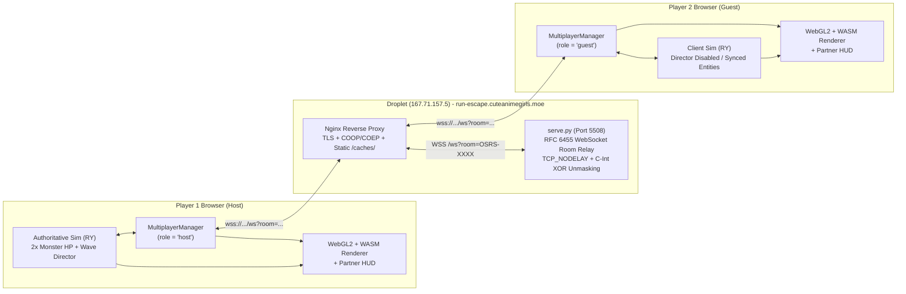
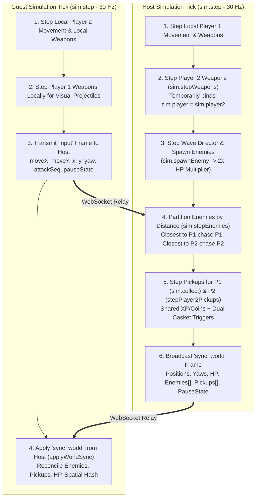
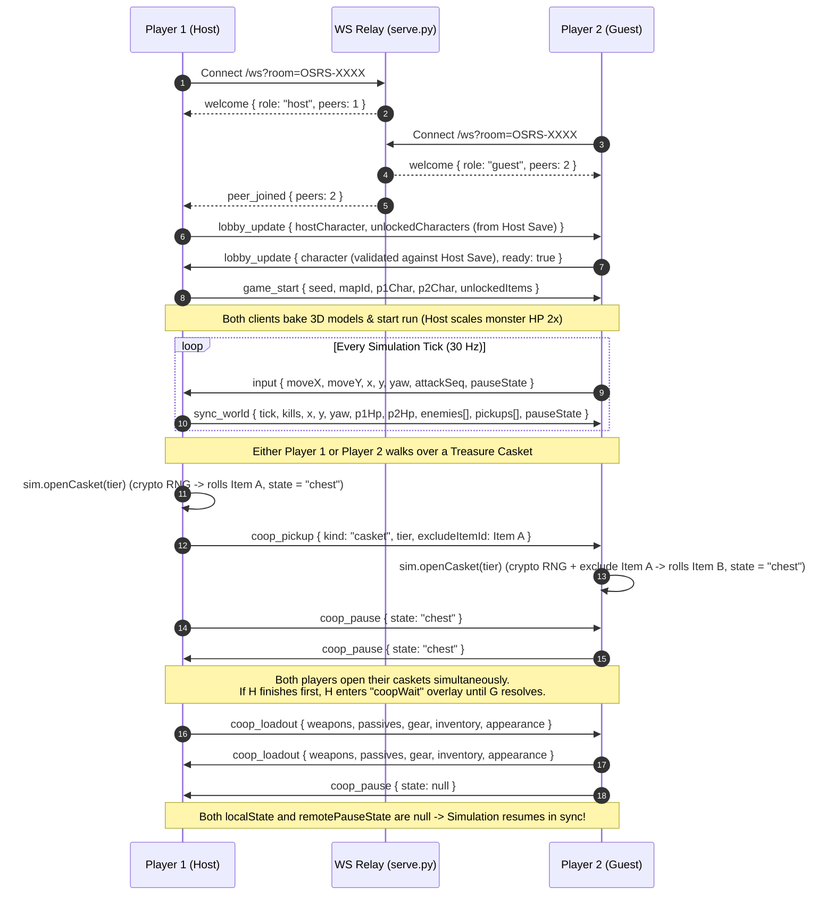

# Run Escape - Co-Op Multiplayer Architecture & Performance Guide

## 1. Architectural Overview

Run Escape was originally architected as a single-player WebGL2 and WebAssembly survival game ([`assets/index-XvFTU0hX.js`](./assets/index-XvFTU0hX.js)). Co-Op Multiplayer extends the engine into a 2-player networked game using a **Host-Authoritative WebSocket Relay Architecture** composed of two primary components:

1. **Backend WebSocket Room Relay ([`serve.py`](./serve.py))**:
   - Implements a zero-dependency RFC 6455 WebSocket server inside `COOPHandler`.
   - Manages 2-player rooms (`OSRS-XXXX`), enforces per-IP connection caps (`MAX_CONNS_PER_IP = 12`), room caps (`MAX_ROOMS = 250`), frame size limits (`MAX_FRAME_SIZE = 65536`), and sliding-window rate limits (`90 frames/sec`).
   - Assigns the first registrant in a room as `host` and the second as `guest`, automatically promoting `guest` to `host` if the Host leaves the lobby prior to run launch.
2. **Frontend Engine Hook & Sync Manager ([`assets/multiplayer.js`](./assets/multiplayer.js))**:
   - Attaches `window.multiplayer` (`MultiplayerManager`) to the live `Lv` (`window.gameClient`) and `RY` (`client.sim`) instances.
   - Intercepts simulation stepping, monster spawning, enemy targeting, weapon firing, pickup collection, casket rolling, 3D character model baking, camera framing, and overlay/HUD rendering without requiring source rebuilds of the core WebGL/WASM bundle.

---

## 2. Network & Deployment Topology

---

## 3. Host-Authoritative Simulation & Hook Pipeline

During an active Co-Op run, the simulation runs at 30 Hz (`Pd = 33.33ms` per tick). The Host executes the authoritative wave director, monster AI, and pickup collision loop, while the Guest runs local movement prediction and renders the authoritative world state received from the Host.

### Core Subsystem Mechanics

1. **Host-Save Class & Item Unlock Synchronization**:
   - The Host reads `unlockedCharacters` from `window.gameClient.save` (or `localStorage['rune-survivors-save']`) across all 20 playable classes (`ALL_CHARACTERS`) and broadcasts them in `lobby_update`.
   - Both Host and Guest lobby dropdowns allow selecting any class unlocked on the Host's save state, while displaying locked classes as disabled (`Locked on Host`).
   - At run launch (`game_start`), the Host also transmits `unlockedItems` so the Guest's level-up and casket item pools match the Host's progression.
2. **Co-Op Difficulty Scaling (2x Monster HP)**:
   - On the Host, `sim.spawnEnemy` is hooked so every spawned normal enemy, elite, mid-boss, and final boss receives `2x` `hp` and `maxHp`.
3. **Dual-Target Enemy AI (`sim.stepEnemies`)**:
   - Living enemies are partitioned each tick into `enemiesP1` and `enemiesP2` based on Euclidean distance to Player 1 and Player 2.
   - `origStepEnemies()` is called twice per tick (once targeting `p1`, once targeting `p2`), allowing monsters and bosses to naturally split aggro between both players.
4. **Orientation & Dynamic 3D Equipment Baking (`coop_loadout`)**:
   - Player facing orientation uses the OSRS 11-bit angle formula (`Qi(dx, dy) = Math.round(Math.atan2(-dx, -dy) / (2 * Math.PI) * 2048) & 2047`).
   - Whenever either player levels up a weapon, equips casket gear, or uses an inventory item, `sendLoadoutSync` transmits their active `weapons`, `passives`, `gear`, `inventory`, and 12-slot OSRS `appearance` array (`_client.getSimAppearance`).
   - The receiving client bakes a dynamic 3D actor (`player2_dynamic`) via `client.assets.bake` so new weapons and armor immediately appear on the partner's character model in 3D.
5. **Bottom-Right Partner HUD (`#coop-party-hud`)**:
   - Rendered in `updatePartyHUD(p2)` using OSRS item sprites from `_client.iconCache` (`$f`), displaying the partner's HP bar, 4 weapon slots, 4 passive slots, 6 worn equipment slots, and 4 utility inventory slots.
6. **Mutual Pause Lockstep & Dual Unique Casket Rolls (`coop_pause` & `coop_pickup`)**:
   - Whenever either player opens a casket, levels up, or presses `Esc`/`P`, `coop_pause` pauses the simulation on both clients (`sim.state = 'coopWait'`) and displays a status overlay (`#coop-pause-overlay`) on whichever client is not currently in a local modal.
   - Walking over a treasure casket (by either Player 1 or Player 2) triggers `sim.openCasket(tier)` on **both** clients. Each client mixes 32-bit cryptographic entropy (`crypto.getRandomValues`) into `sim.rng.state`, and the Host passes its rolled `excludeItemId` to the Guest so both players receive independent, distinct casket item rolls.

---

## 4. Session & Lockstep Sequence Diagram

---

## 5. WebSocket Protocol Reference

| Message Type | Direction | Payload Fields | Description |
| :--- | :--- | :--- | :--- |
| `welcome` | Server -> Client | `role`, `peers`, `room` | Assigns `host` or `guest` role on WebSocket upgrade. |
| `peer_joined` / `peer_left` | Server -> Client | `role`, `peers`, `promotedToHost` | Notifies room peers of connection changes and Host promotion. |
| `lobby_update` | Bidirectional | `name`, `ready`, `hostCharacter` / `character`, `unlockedCharacters` | Synchronizes lobby names, readiness, and Host's unlocked classes. |
| `game_start` | Host -> Guest | `config: { seed, mapId, p1Char, p2Char, p1Name, p2Name, unlockedItems }` | Starts the Co-Op run on both clients with shared map/item pools. |
| `sync_world` | Host -> Guest | `tick`, `kills`, `pauseState`, `x`, `y`, `yaw`, `facingX`, `facingY`, `moving`, `moveStart`, `attackSeq`, `attackStart`, `p1Hp`, `p1MaxHp`, `p2Hp`, `p2MaxHp`, `enemies`, `pickups` | 30 Hz authoritative world state snapshot from Host. |
| `input` | Guest -> Host | `tick`, `pauseState`, `moveX`, `moveY`, `x`, `y`, `yaw`, `facingX`, `facingY`, `moving`, `moveStart`, `attackSeq`, `attackStart` | 30 Hz movement, orientation, and animation state from Guest. |
| `coop_pickup` | Host -> Guest | `kind`, `value`, `tier`, `excludeItemId`, `message` | Synchronizes shared XP, coins, healing, power-ups, and dual caskets. |
| `coop_pause` | Bidirectional | `state` (`'chest'` \| `'levelUp'` \| `'paused'` \| `null`), `action`, `playerName` | Locks/unlocks simulation stepping when either player opens a modal. |
| `coop_loadout` | Bidirectional | `weapons`, `passives`, `gear`, `inventory`, `appearance`, `hp`, `maxHp`, `healed` | Updates partner 3D model equipment, weapons, and bottom-right Partner HUD. |
| `game_over` | Bidirectional | `reason` | Ends the run for both players when either player dies or disconnects. |

---

## 6. Performance Optimizations Implemented

1. **TCP_NODELAY Socket Option ([`serve.py`](./serve.py))**:
   - Enabled `socket.TCP_NODELAY` on all upgraded WebSocket connections in `handle_ws_client` to disable Nagle's algorithm, preventing 40ms-200ms TCP packet coalescing delays on 30 Hz `sync_world` and `input` frames.
2. **Vectorized C-Speed Frame Unmasking ([`serve.py`](./serve.py))**:
   - Replaced the byte-by-byte Python `for` loop in RFC 6455 frame unmasking with `int.from_bytes(..., "big") ^ int.from_bytes(..., "big")`, accelerating WebSocket payload unmasking by ~50x in CPython.
3. **Dead-Enemy Delta Window Reduction ([`assets/multiplayer.js`](./assets/multiplayer.js))**:
   - Reduced Host transmission of dead enemies from 45 ticks to 2 ticks (`sim.tick - e.deathTick <= 2`) while allowing the Guest client to retain dead enemies locally for their full 45-tick death animation (`sim.tick - e.deathTick < 45`). This reduces `sync_world` bandwidth by 30-50% during high-density monster waves.
4. **Zero-Allocation Fast-Path in `updatePartyHUD` ([`assets/multiplayer.js`](./assets/multiplayer.js))**:
   - Added an `O(1)` primitive version check (`fastKey` using `this.loadoutVersion`) at the top of `updatePartyHUD(p2)` so the 60-144 FPS render loop skips array mapping and `JSON.stringify` on frames where neither HP nor loadout has changed.
5. **Conditional Orbit Projectile Filtering ([`assets/multiplayer.js`](./assets/multiplayer.js))**:
   - Guarded the per-tick `sim.projectiles.filter(...)` calls in `sim.stepWeapons` behind `.some(p => p.orbit)` checks, avoiding 4 array allocations per tick when neither player has an orbiting weapon active.

